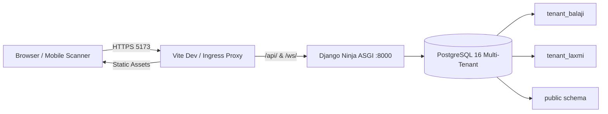

# Swarna Khata Book — Jewellery ERP

Production-grade, multi-tenant Jewellery ERP designed for retail jewelers and bullion traders. Built with **Django Ninja + django-tenants (Backend)**, **React 19 + TypeScript + Tailwind CSS (Frontend)**, and **PostgreSQL 16 (Schema-Isolated Multi-Tenancy)**.

---

## Key Modules & Capabilities

### 1. POS Billing & Wireless Mobile QR Scanner
* **Wireless Mobile Scanner**: Scan a single-use pairing QR code to pair any mobile phone camera via `@zxing/browser` over WebSockets—instantly streaming barcode scans directly into the desktop checkout cart.
* **Smart Valuation Engine**:
  $$\text{Item Price} = (\text{Net Pure Weight} \times \text{Live Metal Rate}) + \text{Making Charges} + \text{Stone Charges}$$
* **Old Gold Buyback & GST**: Built-in old gold exchange deduction and 3% Jewellery GST (1.5% CGST + 1.5% SGST).
* **Immutable Invoices**: Generates cryptographically hashed (SHA-256) customer snapshots and download-ready PDF invoices via ReportLab.

### 2. Bullion Rates & Live Web Scrapers
* **Automated Web Scrapers**: Scrapes benchmark daily bullion rates from **KSJF** (Karnataka), **IBJA** (Mumbai), and **Bullion Desk** (Inter-bank spot parity).
* **Manual Override & Intraday History**: Update purity-specific rates manually with atomic deactivation of prior rates and safe intraday audit preservation.

### 3. Accounting & Cash Drawer Day Book
* **Cash Drawer Tracking**: Record showroom petty cash (`Cash In` / `Cash Out`) with real-time balance computation.
* **Audit Closing & Reopen**: Finalize day-close cash balances with one-click audit locking, and reopen when corrections are required (Owner/Manager).

### 4. Enterprise Multi-Tenancy & Hierarchical RBAC
* **PostgreSQL Schema Isolation**: Each jewelry business runs on its own isolated database schema via `django-tenants`.
* **5-Tier Hierarchical RBAC**:
  - `Superadmin (100)`: Obsidian Developer Control Plane, tenant provisioning, cross-store global data export.
  - `Owner (80)`: Full store control, Invoice Studio branding, and shop data export.
  - `Showroom Manager (60)`: Staff management, inventory pricing, rate overrides, day-book closing.
  - `Accountant (40)`: Ledgers, day-book journal entries, cash vouchers.
  - `Salesman / Staff (20)`: Catalog lookup, POS billing, and mobile scanner pairing.

### 5. Large Data Export Engine
* Memory-efficient streaming export (CSV / NDJSON) with preset filters (Today, 30 Days, 90 Days, FY 24-25, or custom ranges) supporting background downloads without HTTP gateway timeouts.

---

## Architecture Overview



---

## Quick Start (Local Development)

### Prerequisites
- **Python 3.12 (64-bit)** with [`uv`](https://docs.astral.sh/uv/)
- **Node.js 20+** & npm
- **PostgreSQL 16** (running on port `5433` or `5432` per `backend/.env`)

### 1. 1-Click Launch (Windows)
Double-click [`run_local.bat`](./run_local.bat) to sync dependencies and launch both servers simultaneously:
- **Frontend App**: `http://localhost:5173`
- **Backend API**: `http://localhost:8000/api/`
- **Developer Control Plane**: `http://localhost:5173/developer`

**Default Credentials**:
- Store Owner / Admin: `admin` / `admin123`
- Developer Portal: `dev_admin` / `Obsidian@Dev2026#Access`

---

### 2. Manual Commands

#### Backend
```powershell
uv sync
uv run --directory backend python manage.py migrate
uv run --directory backend python seed_data.py
uv run --directory backend uvicorn config.asgi:application --host 0.0.0.0 --port 8000 --reload
```

#### Frontend
```powershell
cd frontend
npm install
npm run dev
```

---

## Remote Access via Cloudflare Quick Tunnel

To test on physical smartphones or access remotely **without exposing your backend port 8000**:

```bash
.\run_tunnel.bat
# OR: npm run tunnel (from frontend/)
# OR: cloudflared tunnel --url http://127.0.0.1:5173
```
*Vite's internal reverse proxy securely routes all `/api/*`, `/media/*`, and WebSocket traffic over localhost to Django, keeping your backend and database completely unexposed.*

---

## Testing & Verification

```powershell
# Run Backend Test Suite (Daybook, Scrapers, Multi-Tenant Isolation)
cd backend
..\.venv\Scripts\python manage.py test tests.test_daybook_accounting tests.test_multi_source_scraper --noinput

# Run Frontend Typecheck & Production Build
cd frontend
npm run build

# Run Playwright End-to-End Test Suite (17 Tests)
cd frontend
npx playwright test
```
